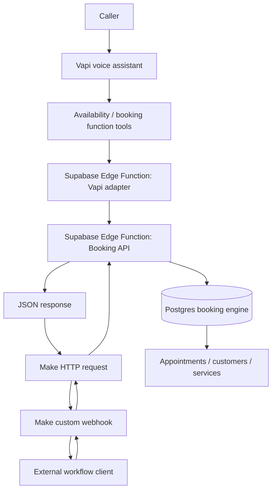

# AI Voice Receptionist & Business Booking Agent

An AI-powered receptionist prototype for a fictional dental clinic. It answers spoken enquiries, checks live appointment availability, collects booking details, and creates appointments through a secured backend.

> **Project status (17 November 2026):** The Supabase database and booking engine are implemented; the Make webhook orchestration is active; the Vapi assistant has working availability and booking tools configured. A real voice test successfully retrieved available slots, and a disposable database test exercised availability → booking → cancellation inside a rolled-back transaction. Full live voice booking confirmation, cancellation/rescheduling from the assistant, notification delivery, and browser-demo packaging remain to be completed. This is a portfolio prototype, not a production clinic system.

## 1. Business problem

Small service businesses often handle appointment enquiries and bookings manually. Staff must answer repetitive questions, check calendars, collect customer details, and avoid double-booking. An AI receptionist can handle the routine interaction while keeping the booking operation connected to a controlled source of truth.

## 2. Solution overview

The voice assistant speaks with callers and invokes narrowly scoped tools. A Supabase Edge Function validates the request, then calls database booking functions using a server-side service-role credential. A separate Make webhook provides an integration/orchestration path to the same booking API.

### Architecture

## 3. Technology stack

- **Vapi:** conversational voice agent, function tools, turn-taking and idle prompts.
- **Google Gemini:** language model used by the assistant.
- **Deepgram Nova-3:** speech transcription, configured for automatic language handling.
- **Supabase Postgres:** multi-tenant relational data model and booking rules.
- **Supabase Edge Functions:** authenticated booking API and Vapi tool adapter.
- **Make.com:** webhook orchestration and HTTP integration.
- **PowerShell:** local integration checks during development.

## 4. Booking workflow

1. The caller states the service and requested date.
2. The assistant confirms the full calendar date, including the year.
3. The availability tool requests slots for the selected service and date.
4. The backend returns only valid future slots within business hours and without active appointment conflicts.
5. The assistant offers returned slots; it must not invent availability.
6. The assistant collects the caller's name and phone number.
7. Before creating the appointment, the assistant repeats the service, full date, time, name and phone number and obtains explicit confirmation.
8. The booking tool submits the request. The assistant confirms only after a successful backend response.

## 5. Database model

The demo uses six tables:

| Table | Purpose |
|---|---|
| `businesses` | Business identity, active state and timezone |
| `customers` | Customer contact details scoped to a business |
| `services` | Service names, durations and demo prices |
| `business_hours` | Weekly opening hours |
| `appointments` | Appointment lifecycle, resource and time range |
| `call_logs` | Call metadata and outcome tracking |

Appointments use a Postgres exclusion constraint to prevent overlapping active bookings for the same business/resource. Customer and service foreign keys are scoped to the same business. Timestamps are stored as `timestamptz`; the demo business uses `Asia/Kolkata`.

The fictional business is **Aarogya Dental Studio**, with six synthetic dental services and sample opening hours. Contact details and prices are placeholders for demonstration only.

## 6. Backend functions and security

Database functions:
- `get_available_slots`
- `create_booking`
- `cancel_booking`
- `reschedule_booking`

Edge Functions:
- `receptionist-booking-api`: validates a shared API key and routes availability, booking, cancellation and rescheduling actions to Postgres RPCs.
- `vapi-receptionist-tools`: validates a separate Vapi tool key, translates Vapi function-call envelopes into booking API requests, and returns Vapi-compatible tool results.

Security decisions:
- Row Level Security is enabled on all six public tables.
- No broad anonymous or authenticated policies are present; direct public table access remains blocked.
- Booking RPC execution is revoked from `public`, `anon` and `authenticated`, and granted to `service_role`.
- The service-role key is held server-side and is never sent to the browser or voice assistant.
- The Vapi adapter has its own credential and does not expose the internal booking API credential.
- Secrets are intentionally excluded from this repository.

## 7. Make orchestration

The active Make scenario, **Project 04 - Receptionist Booking Webhook**, contains:
1. Custom webhook trigger.
2. HTTP POST to the Supabase booking API.
3. Webhook response mapped from the API response.

A controlled availability test returned 34 slots for 18 November 2026. The scenario was verified active with no incomplete executions during the latest status check.

## 8. Testing evidence

| Test | Result |
|---|---|
| Direct booking API availability test | Returned 34 slots for 18 Nov 2026 |
| Vapi adapter format/authentication test | Returned Vapi-compatible `results[]` with available slots |
| Live Vapi voice availability test | Assistant successfully checked availability and offered real returned slots |
| Diagnostic log verification | A voice request for Routine Dental Check-up on 19 Nov 2026 resolved the service and returned 35 slots |
| Database transaction test | Availability → create synthetic booking → cancel booking completed without exception; transaction rolled back |
| Post-test database check | 1 business, 6 services, 0 customers, 0 appointments, 0 call logs |

The database test used a synthetic customer and an invalid example email domain; all changes were rolled back. No test appointment or customer was retained.

## 9. Current limitations

- The complete voice booking journey still needs a live end-to-end test through successful creation and spoken confirmation.
- Cancellation and rescheduling exist in the backend adapter but do not yet have configured assistant tools.
- Confirmation messages, staff notifications, call-log persistence and operational failure alerts are not yet verified.
- Browser-based voice demo packaging is still pending.
- Indian PSTN number support has not been established for this Vapi setup; the planned portfolio demonstration should use a browser voice interface unless a compliant telephony route is separately validated.
- The clinic and its service prices are fictional. The agent is administrative only and must not diagnose conditions or recommend treatment.

## 10. Next steps

1. Run a complete voice booking test: availability → details → explicit confirmation → booking success → spoken confirmation.
2. Add Vapi cancellation and rescheduling tools and test them with synthetic appointments.
3. Add call-log writes, booking confirmations and staff escalation/notification paths.
4. Add robust failure handling for invalid dates, unavailable slots, conflicts, malformed tool arguments and backend timeouts.
5. Package a browser voice demo and record a short walkthrough.
6. Remove temporary diagnostic logging after the integration test phase.
7. Capture screenshots, execution evidence and a concise project demo for the portfolio.

## Safety boundary

This is a fictional administrative booking demonstration. It is not connected to a real dental clinic, does not provide medical advice, and is not represented as production-ready.
