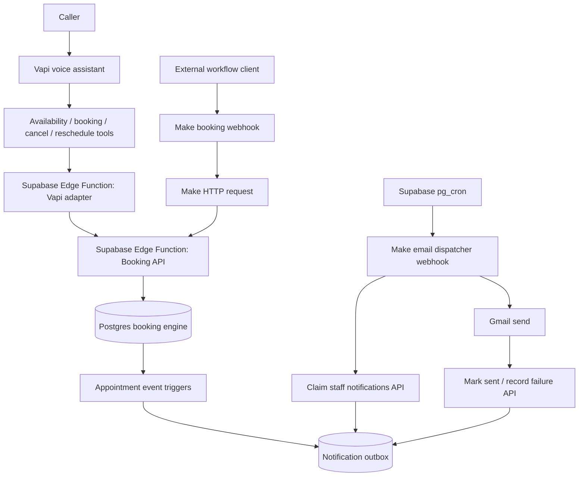

# AI Voice Receptionist & Business Booking Agent

An AI receptionist platform being evolved into a multi-tenant SaaS for dental clinics. The original single-clinic voice demo remains intact while a separate, zero-cost-quoted Supabase staging project now holds the SaaS database foundation.

> **Project status (19 November 2026):** The legacy single-clinic voice demo remains operational and separate. SaaS staging has been created in Supabase at a quoted $0/month. Its foundation includes 10 tenant-scoped tables, RLS on all 10, 26 role-aware policies, owner/admin/staff memberships, protected business onboarding, and four SECURITY INVOKER booking RPCs. Security advisor returned no findings. Authenticated signup/onboarding, cross-tenant attack tests, dashboard, tenant-aware Vapi/Make provisioning, a staging Make dispatcher, end-to-end signup and full regression remain. This is an early SaaS foundation, not a production-ready product.

## 1. Business problem

Small service businesses often handle appointment enquiries and bookings manually. Staff must answer repetitive questions, check calendars, collect customer details, and avoid double-booking. An AI receptionist can handle routine interactions while keeping booking operations connected to a controlled source of truth.

## 2. Solution overview

The legacy voice assistant speaks with callers and invokes narrowly scoped tools. Its Edge Functions and Make scenarios remain connected to the original demo project. SaaS staging is deliberately separate; do not point existing Vapi or Make integrations at it until tenant identity, authorization and per-clinic routing have been redesigned.

### Architecture

## 3. Technology stack

- **Vapi:** conversational voice agent, function tools, turn-taking and idle prompts.
- **Google Gemini:** language model used by the assistant.
- **Deepgram Nova-3:** speech transcription, configured for automatic language handling.
- **Supabase Postgres:** multi-tenant relational data model, booking rules and notification outbox.
- **Supabase Edge Functions:** authenticated booking API, Vapi tool adapter and notification-outbox API.
- **Make.com:** booking webhook orchestration and scheduled email dispatch workflow.
- **Gmail:** staff notification delivery for the demo.
- **PowerShell:** local integration checks during development.

## 4. Booking workflow

1. The caller states the service and requested date.
2. The assistant confirms the full calendar date, including the year.
3. The availability tool requests slots for the selected service and date.
4. The backend returns only valid future slots within business hours and without active appointment conflicts.
5. The assistant offers returned slots; it must not invent availability.
6. The assistant collects the caller's name and phone number.
7. Before creating the appointment, the assistant repeats the service, full date, time, name and phone number and obtains explicit confirmation.
8. The booking tool submits the request. The assistant confirms only after a successful backend response.
9. The assistant can also cancel or reschedule using the human-readable appointment reference.

## 5. Database model

The legacy demo database uses seven tables:

| Table | Purpose |
|---|---|
| `businesses` | Business identity, active state, timezone and staff notification address |
| `customers` | Customer contact details scoped to a business |
| `services` | Service names, durations and demo prices |
| `business_hours` | Weekly opening hours |
| `appointments` | Appointment lifecycle, booking reference, resource and time range |
| `call_logs` | Call metadata and outcome tracking |
| `notification_outbox` | Idempotent appointment-event email queue, retry state and provider response |

Appointments use a Postgres exclusion constraint to prevent overlapping active bookings for the same business/resource. Customer and service foreign keys are scoped to the same business. Timestamps are stored as `timestamptz`; the demo business uses `Asia/Kolkata`.

### SaaS staging schema

A separate Supabase project, `Project-04-SaaS-Staging-Mumbai` (Mumbai region), contains 10 empty application tables: `businesses`, `business_memberships`, `services`, `business_hours`, `customers`, `appointments`, `call_logs`, `notification_outbox`, `business_integrations` and `audit_logs`. Membership roles are `owner`, `admin` and `staff`. RLS is enabled on all 10 tables with 26 tenant/role-scoped policies. Business onboarding creates the business for the authenticated user and assigns the owner role through a protected trigger. Booking RPCs use `SECURITY INVOKER`; booking creation validates contact inputs and supports a per-business idempotency key. No demo customer, appointment or call-log data was copied into staging.

The fictional business is **Aarogya Dental Studio**, with synthetic dental services, sample prices and opening hours. Contact details and prices are placeholders for demonstration only.

## 6. Backend functions and security

Database functions:
- `get_available_slots`
- `create_booking`
- `cancel_booking`
- `reschedule_booking`
- `claim_email_notifications`
- `set_email_notification_result`

Edge Functions:
- `receptionist-booking-api`: validates a shared API key and routes availability, booking, cancellation and rescheduling actions to Postgres RPCs.
- `vapi-receptionist-tools`: validates a separate Vapi tool key, translates Vapi function-call envelopes into booking API requests, and returns Vapi-compatible tool results.
- `notification-outbox-api`: authenticates Make requests and exposes controlled claim/result operations for the email outbox.

Security decisions:
- Legacy demo project: RLS is enabled on all seven tables and direct table access is intentionally blocked; its privileged integration functions remain server-side.
- SaaS staging: RLS is enabled on all 10 tables with membership/role-aware policies. The business-onboarding RPC is `SECURITY INVOKER`; a narrowly scoped owner-membership trigger lives in the non-exposed `private` schema. Booking RPCs are also `SECURITY INVOKER` and check business membership.
- The Supabase security advisor returned no findings on staging after the onboarding function was changed to `SECURITY INVOKER`.
- The service-role key is held server-side and is never sent to the browser or voice assistant.
- The Vapi adapter has its own credential and does not expose the internal booking API credential.
- The notification worker claims only staff notifications whose recipient matches the business's currently configured notification email.
- Secrets are intentionally excluded from this repository.

## 7. Make orchestration

### Booking webhook

The active Make scenario, **Project 04 - Receptionist Booking Webhook**, contains:
1. Custom webhook trigger.
2. HTTP POST to the Supabase booking API.
3. Webhook response mapped from the API response.

It supports availability, booking, cancellation and rescheduling requests.

### Email dispatcher

The active Make scenario, **Project 04 - Email Notification Dispatcher**, contains:
1. Custom webhook trigger (invoked by Supabase cron).
2. Claim due staff email notifications from the outbox API.
3. Iterate over claimed notifications.
4. Send the email through Gmail.
5. Mark the notification sent with the provider message ID.
6. On Gmail module failure, record a failed attempt for retry.

Supabase `pg_cron` invokes the Make dispatcher webhook every minute. The outbox uses a processing lease, bounded attempts and exponential retry backoff. The worker is deliberately restricted to staff email; customer email delivery is not enabled.

## 8. Testing evidence

| Test | Result |
|---|---|
| Live Vapi availability | Assistant checked availability and offered returned slots |
| Voice booking | Test booking completed after explicit confirmation; human-readable reference returned |
| Voice rescheduling | Test appointment successfully rescheduled using its booking reference |
| Voice cancellation | Test appointment cancellation confirmed in the database |
| Date validation | Explicit full dates work; invalid/past dates are rejected by the backend |
| Appointment event triggers | Rolled-back SQL test verified one staff outbox event each for confirmation, cancellation and rescheduling |
| Staff email dispatch | Corrected staff inbox test processed through all five Make modules and confirmed received by the user |
| Cron health | 25 successful runs and zero failed runs in a 30-minute inspection window |
| Security/performance review | RLS posture reviewed; missing outbox business-FK index added; no health advisor findings |

The trigger QA ran inside a rolled-back transaction, so no synthetic appointments or email events from that test were retained. The email test was a clearly labelled synthetic staff notification, not a real customer booking.

## 9. Current limitations

- The complete voice booking, cancellation and rescheduling flows have been tested, but a final broad regression across conflicts, caller corrections, invalid input and timeouts is still needed.
- Email provider acceptance and one confirmed inbox receipt were verified; future delivery is not guaranteed.
- If Gmail sends successfully but the subsequent status callback fails, a retry could produce a duplicate email. Exactly-once email delivery is not guaranteed.
- A durable staff escalation/dead-letter review workflow is not yet implemented. No SMS or secondary alert channel is configured.
- Customer confirmation emails are not enabled in the dispatcher.
- Browser-based voice demo packaging is still pending.
- Indian PSTN number support has not been established for this Vapi setup; the planned portfolio demonstration should use a browser voice interface unless a compliant telephony route is separately validated.
- The clinic and its service prices are fictional. The agent is administrative only and must not diagnose conditions or recommend treatment.

## 10. Next steps

1. Finish and version-control the SaaS database migrations; test signup, business onboarding and owner/admin/staff permissions.
2. Add automated cross-tenant isolation tests, including attempts to read or mutate another clinic's customers, appointments, logs and integrations.
3. Build a free-tier web dashboard for clinic onboarding, services, hours, appointments and team access.
4. Redesign Edge Functions and Vapi/Make integration routing so tenant identity is derived from authenticated credentials, never caller-supplied `business_id`.
5. Connect a tenant-safe Make email dispatcher to staging; test retries, staff recipient isolation and duplicate-send behaviour.
6. Package a browser-based voice demo using free/available quotas; do not promise PSTN calls without a verified free route.
7. Only after the platform is secure, build the public landing page, demo and launch/marketing materials.

## Safety boundary

This is a fictional administrative booking demonstration. It is not connected to a real dental clinic, does not provide medical advice, and is not represented as production-ready.
