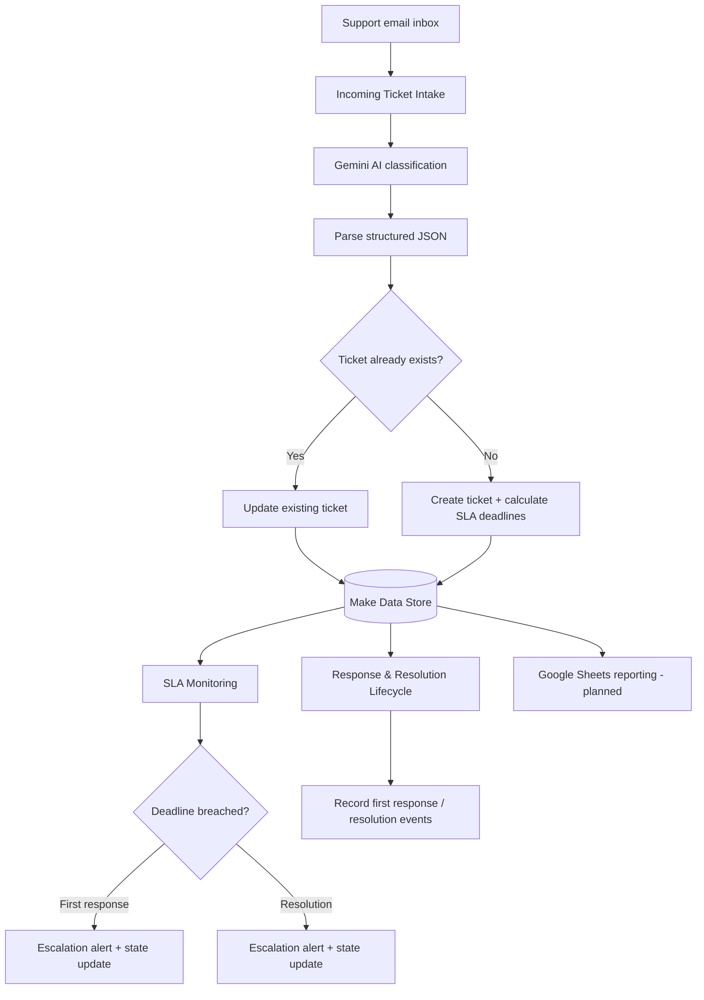

# AI Support Desk & SLA Incident Manager

An AI-assisted support operations workflow that classifies incoming support emails, maintains ticket state in an operational database, tracks calendar-hour service-level agreements (SLAs), and escalates overdue incidents.

> **Project status:** Core database foundation and SLA-monitoring logic are built. The SLA monitor has passed controlled tests for independent first-response and resolution breaches. End-to-end Gmail intake and response-lifecycle testing remain in progress. All scenarios are kept inactive outside controlled tests; this is a portfolio prototype, not a production service.

## 1. Business problem

Support teams need to do more than read and answer incoming emails. They must identify what each issue is about, assess urgency, maintain a reliable ticket history, meet response and resolution commitments, and escalate overdue work without sending duplicate alerts.

When ticket information is spread across inboxes and spreadsheets, teams can lose track of ownership, deadlines, and the latest status.

## 2. Proposed solution

The system uses AI to structure incoming support requests and Make.com to coordinate ticket processing. A Make Data Store acts as the operational source of truth. Separate scenarios handle intake, SLA monitoring, and response/resolution lifecycle events.

### High-level architecture

## 3. Scenario responsibilities

| Scenario | Responsibility | Current state |
|---|---|---|
| AI Support Desk & SLA Incident Manager | Watch new support emails, classify them with Gemini, search by ticket ID, then update or create a ticket | Built; end-to-end intake test pending |
| AI Support Desk — SLA Monitoring & Escalations | Search unresolved tickets, evaluate first-response and resolution deadlines independently, send escalation alerts, and update ticket state | Controlled breach tests passed; inactive |
| AI Support Desk — Response & Resolution Lifecycle | Observe sent support replies and update the matching ticket's first-response timestamp and SLA result | Built; trigger and end-to-end test pending |

## 4. Ticket lifecycle

1. A new support email arrives in the dedicated support inbox.
2. Gemini classifies the request and returns structured fields such as category, priority, sentiment, summary, and assigned team.
3. Make parses the structured response.
4. The workflow searches the Data Store for the ticket associated with the Gmail thread.
5. If a matching ticket exists, it updates the existing record without resetting the original SLA clock. Otherwise, it creates a new ticket and calculates its deadlines.
6. The SLA monitor periodically checks unresolved tickets.
7. When a deadline is breached, the relevant escalation path sends an internal alert and updates the ticket's SLA status and escalation metadata.
8. The response/resolution lifecycle scenario is intended to record the first human response and eventual resolution. Customer replies are not sent automatically by this prototype.

## 5. SLA policy

SLAs use **calendar hours**, not business hours. Deadlines therefore continue through nights, weekends, and holidays.

| Priority | First response target | Resolution target |
|---|---:|---:|
| P1 — Critical | 1 hour | 4 hours |
| P2 — High | 4 hours | 12 hours |
| P3 — Normal | 8 hours | 24 hours |
| P4 — Low | 24 hours | 72 hours |

**Example:** A P1 ticket created at 10:00 has a first-response deadline of 11:00 and a resolution deadline of 14:00, using the same local timezone.

The monitor is configured to run every **15 minutes**, the minimum interval available on the current Make plan. This means a breach alert may be delayed until the next scheduled check; the monitor is not real-time.

## 6. Operational data model

The Make Data Store named `AI Support Desk — Ticket Database` is the operational database. Its records use the strict `Support Ticket Record` data structure.

The schema contains 31 fields, grouped by purpose:

| Field group | Fields |
|---|---|
| Identity and source | `ticket_id`, `source`, `source_event_id`, `last_source_event_id` |
| Customer and request | `customer_name`, `customer_email`, `subject`, `description` |
| AI classification | `category`, `priority`, `sentiment`, `ai_summary`, `assigned_team` |
| Ticket state | `ticket_status`, `internal_notes`, `created_by`, `created_at`, `updated_at` |
| First-response SLA | `first_response_target_hours`, `first_response_sla_status`, `first_response_due_at`, `first_response_at` |
| Resolution SLA | `resolution_target_hours`, `resolution_sla_status`, `resolution_due_at`, `resolved_at` |
| Pause and escalation | `paused_at`, `total_paused_minutes`, `escalation_level`, `last_escalated_at`, `last_escalation_reason` |

Timestamps are stored as text in ISO-style date-time format with timezone information. The schema includes pause-related fields for future pause/resume handling; the current SLA policy and monitor are designed around calendar-hour deadlines.

### Database behaviour

- Search by the ticket identifier derived from the email thread.
- Update an existing record when a matching ticket is found.
- Create a record when no matching ticket exists.
- Preserve existing ticket and SLA fields during updates rather than resetting the original creation/deadline timestamps.
- Store first-response and resolution SLA states independently.
- Record escalation level, timestamp, and reason to support operational traceability.

## 7. SLA monitoring and escalation logic

The SLA monitor searches for tickets whose status is not `RESOLVED`. It then evaluates the first-response and resolution paths independently.

A ticket is eligible for a breach path when:
- the relevant SLA status is `PENDING`;
- the ticket is not currently paused; and
- the relevant due timestamp is less than or equal to the current time.

On a first-response breach, the workflow marks `first_response_sla_status` as `BREACHED`. If the resolution deadline has also passed and its status is still pending, that status is updated as well.

On a resolution breach, the workflow marks `resolution_sla_status` as `BREACHED`. If the first-response deadline is also overdue and still pending, that status is updated too.

This cross-update prevents a ticket that has missed both deadlines from remaining incorrectly pending in one SLA dimension. Escalation metadata records the level, time, and reason. The monitor's current test configuration excludes the retained seed record `TKT-TEST-0001`.

## 8. Technology stack

- **Make.com:** scenario orchestration, scheduling, routing, filters, and data operations
- **Google Gemini:** support-ticket classification and structured AI output
- **Gmail:** support inbox intake and sent-reply event source
- **Make Data Store:** operational ticket database
- **Slack:** internal escalation notifications
- **Google Sheets:** intended reporting / audit view; not the operational source of truth

## 9. Testing and verification

### Confirmed controlled test

The SLA monitoring scenario was run against two temporary synthetic records with overdue deadlines:

| Test case | Expected result | Observed result |
|---|---|---|
| First-response deadline overdue; resolution deadline in the future | First-response status becomes `BREACHED`; resolution remains `PENDING`; escalation level 1 | Confirmed |
| Resolution deadline overdue; first-response status already `MET` | Resolution status becomes `BREACHED`; first-response remains `MET`; escalation level 2 | Confirmed |

Both temporary test records were deleted after the test. The seed record `TKT-TEST-0001` remains in the Data Store and is excluded from monitoring.

The scenario execution completed successfully and the Data Store updates were verified. Slack notification modules were included in the executed routes, but message delivery was not independently verified through Slack history.

### Still to test

- End-to-end receipt of a new email by the Gmail intake trigger.
- Gemini classification accuracy across different support categories and ambiguous requests.
- Correct create-versus-update behaviour for new messages and replies in an existing Gmail thread.
- First-response event capture from the intended support mailbox.
- Resolution event capture and status transition.
- Duplicate event handling and alert idempotency under repeated runs.
- Timezone and daylight-saving edge cases where applicable.
- Error handling for malformed AI output, missing fields, and temporary app failures.

## 10. Known limitations and next improvements

1. **End-to-end validation:** Intake and lifecycle scenarios still need controlled real-email tests.
2. **Duplicate protection:** Strengthen event-level idempotency so repeated trigger deliveries cannot create duplicate tickets or repeat side effects.
3. **Resolution workflow:** Complete and test the resolution event and status transition.
4. **Human ownership:** Add an explicit assignment/ownership workflow and escalation recipients by priority or team.
5. **Operational reporting:** Add a Google Sheets reporting layer for open tickets, SLA compliance, breach counts, and ageing. The Data Store remains the source of truth.
6. **Error handling:** Add deliberate handling for malformed AI responses, missing customer data, and failed downstream operations.
7. **Production readiness:** Add access controls, retention rules, monitoring, recovery procedures, and broader load testing before any real customer deployment.

## 11. Safety and operating boundaries

- Scenarios are kept inactive except during controlled tests.
- The prototype does not automatically send customer-facing replies.
- Escalation messages are internal notifications.
- Google Sheets is intended for reporting, not as the authoritative ticket database.
- No production-readiness claim is made until end-to-end, failure-path, and duplicate-event testing is complete.

## 12. Make scenarios

- [Incoming Ticket Intake](https://us2.make.com/3360492/scenarios/6966106)
- [SLA Monitoring & Escalations](https://us2.make.com/3360492/scenarios/6975614)
- [Response & Resolution Lifecycle](https://us2.make.com/3360492/scenarios/6975772)

---

*Built as a hands-on portfolio project to demonstrate AI integration, workflow orchestration, operational database design, date/time logic, SLA monitoring, and incident escalation.*
